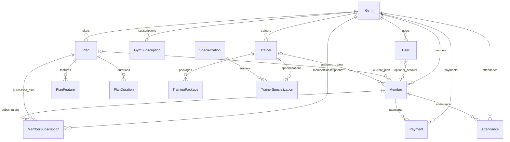

This is a [Next.js](https://nextjs.org) project bootstrapped with [`create-next-app`](https://nextjs.org/docs/app/api-reference/cli/create-next-app).

## Getting Started

First, run the development server:

```bash
npm run dev
# or
yarn dev
# or
pnpm dev
# or
bun dev
```

Open [http://localhost:3000](http://localhost:3000) with your browser to see the result.

You can start editing the page by modifying `app/page.tsx`. The page auto-updates as you edit the file.

This project uses [`next/font`](https://nextjs.org/docs/app/building-your-application/optimizing/fonts) to automatically optimize and load [Geist](https://vercel.com/font), a new font family for Vercel.

## Learn More

To learn more about Next.js, take a look at the following resources:

- [Next.js Documentation](https://nextjs.org/docs) - learn about Next.js features and API.
- [Learn Next.js](https://nextjs.org/learn) - an interactive Next.js tutorial.

You can check out [the Next.js GitHub repository](https://github.com/vercel/next.js) - your feedback and contributions are welcome!

## Deploy on Vercel

The easiest way to deploy your Next.js app is to use the [Vercel Platform](https://vercel.com/new?utm_medium=default-template&filter=next.js&utm_source=create-next-app&utm_campaign=create-next-app-readme) from the creators of Next.js.

Check out our [Next.js deployment documentation](https://nextjs.org/docs/app/building-your-application/deploying) for more details.


npx prisma studio    for viewing entire data in prisma
npx tsx app/login/script.tsx      to run specific prisma file....

## Dashboard header buttons

Use [DashboardHeaderButton](components/dashboard-header-button.tsx) for the top-right actions in dashboard page headers. It keeps every action at the same height, text size, padding, and icon size.

Pass a Lucide `icon`, `text`, and a named `bgColor` (`transparent` or `primary`). For two header actions, the first uses `transparent` and the second uses `primary`: black in light mode and white in dark mode, using the theme tokens in `app/colors.css`. A single header action uses `primary`. Use `href` for navigation or `onClick` for exports and opening a modal in a client component.

```tsx
import { Plus, Download } from "lucide-react"
import { DashboardHeaderButton } from "@/components/dashboard-header-button"

// Navigate to another page.
<DashboardHeaderButton
  icon={Plus}
  text="Add Member"
  bgColor="primary"
  href="/dashboard/members/create"
/>

// Open a modal using the parent component's state.
<DashboardHeaderButton
  icon={Plus}
  text="Add Expense"
  bgColor="primary"
  aria-haspopup="dialog"
  onClick={() => setAddingExpense(true)}
/>

// Run a secondary action, placed before the primary button.
<DashboardHeaderButton
  icon={Download}
  text="Export Report"
  bgColor="transparent"
  onClick={exportReport}
/>
```

The component also supports `disabled` for actions and composition with `DialogTrigger` through its `render` prop. Change sizing in the shared component rather than individual callers.

## Database schema

PulseFit uses PostgreSQL through Prisma, with **14 models and 12 enums** across nine schema files. [prisma.config.ts](prisma.config.ts) loads the schemas from [prisma/schema](prisma/schema) and reads the connection URL from `DATABASE_URL`. The Prisma files are the source of truth; keep this reference synchronized when they change.

### Relationships



`||` means exactly one; `o|` means zero or one; `o{` means zero or many. Each foreign-key field points to the related model's `id`. The join table uses its two foreign-key fields together as its composite primary key.

### How the model works

- Gym is the tenant/organization record. Users, plans, members, trainers, gym subscriptions, member subscriptions, payments, and attendance have a gymId foreign key.
- GymSubscription records a gym's PulseFit platform subscription (BASIC, PRO, PREMIUM). MemberSubscription records a member's purchase of a gym's Plan. These are separate systems.
- Member optionally references a User account, a current Plan, and an assigned Trainer. The API requires plan/start date/duration for new members, while the database allows null for older records.
- MemberSubscription stores the purchased plan, price, special discount, currency, start/end dates, and status. Member.durationMonths stores the purchased duration independently of later plan changes; there is no PlanDuration foreign key on MemberSubscription.
- Payment references Gym and Member. It has no direct subscription, plan, invoice, or trainer foreign key and no currency column.
- Attendance references Gym and Member. The unique memberId + attendanceDate constraint allows one attendance row per member per calendar date.
- Trainer and Specialization have a many-to-many relationship through TrainerSpecialization. Specialization names are global; Specialization has no gymId.
- Trainer owns TrainingPackage records. There is no booking, purchased-package, session, or member-to-package relation in the schema.
- Trainer has no User foreign key. A User with role TRAINER is not automatically linked to a Trainer profile by the database.

### Constraints and deletion behavior

- All models except TrainerSpecialization use String id values with cuid() defaults. TrainerSpecialization uses the composite primary key (trainerId, specializationId).
- Globally unique: Gym.organizationName, Gym.slug, User.email, Specialization.name, Member.userId when non-null.
- Unique per gym: Member.email, Trainer.email, Plan.name. Member.email is nullable.
- PlanDuration is unique by (planId, durationMonths); Attendance by (memberId, attendanceDate).
- Deleting a Plan cascades to its PlanFeature and PlanDuration rows. Member.plan explicitly uses Restrict.
- Deleting a Trainer clears Member.trainerId and cascades to TrainingPackage and TrainerSpecialization rows.
- Deleting a Specialization cascades to its TrainerSpecialization rows.
- Other relations do not specify onDelete in the Prisma source; do not assume deleting a Gym cascades to its dependent records.
- Separate gymId/memberId/planId/trainerId foreign keys do not themselves enforce that the related records all belong to the same gym. The member creation API explicitly checks gym ownership for the selected plan and trainer.
- The database permits multiple GymSubscription and MemberSubscription records, including multiple ACTIVE rows; it does not define a uniqueness constraint for one active subscription.
- The *Minor money fields are integer minor currency units (paisa for PKR). Trainer compensation and TrainingPackage.price use Float; GymSubscription.price uses Int without a Minor suffix.

### Current application usage

Signup creates Gym, an ADMIN User, and GymSubscription together. Member creation creates Member, MemberSubscription, and optionally Payment in one transaction. Plan creation supports nested features and durations. Trainer creation supports specialization connections. Attendance endpoints read/write Attendance.

The overview, payments, reports, and memberships dashboard pages currently import local sample datasets. Displayed invoices, expenses, budgets, and add-ons do not have corresponding Prisma models. TrainingPackage is defined but is not created by the trainer creation endpoint.

Request validation is separate from database structure. Zod schemas exist in lib/validators/member.ts, lib/validators/plan.ts, lib/validators/trainer.ts, and inline attendance/plan API validators. They do not create database tables or relationships.

### Complete Prisma schemas

All model fields, enums, defaults, indexes, and relationships are included below. Paths in the generator configuration are relative to the original schema location.

#### [schema.prisma](prisma/schema/schema.prisma)

```prisma
generator client {
  provider = "prisma-client"
  output   = "../../lib/generated/prisma"
}

datasource db {
  provider = "postgresql"
}
```

#### [gym.prisma](prisma/schema/gym.prisma)

```prisma
enum GymStatus {
  ACTIVE
  INACTIVE
}

model Gym {
  id               String    @id @default(cuid())
  organizationName String    @unique
  slug             String    @unique
  timeZone         String    @default("Asia/Karachi")
  status           GymStatus @default(ACTIVE)
  createdAt        DateTime  @default(now())

  users               User[]
  subscriptions       GymSubscription[]
  plans               Plan[]
  members             Member[]
  trainers            Trainer[]
  memberSubscriptions MemberSubscription[]
  payments            Payment[]
  attendance          Attendance[]
}
```

#### [user.prisma](prisma/schema/user.prisma)

```prisma
enum Role {
  ADMIN
  TRAINER
  MEMBER
}

model User {
  id       String @id @default(cuid())
  gymId    String
  email    String @unique
  password String
  role     Role

  gym    Gym     @relation(fields: [gymId], references: [id])
  member Member?

  @@index([gymId, role])
}
```

#### [subscription.prisma](prisma/schema/subscription.prisma)

```prisma
enum Tier {
  BASIC
  PRO
  PREMIUM
}

enum SubscriptionStatus {
  TRIAL
  ACTIVE
}

model GymSubscription {
  id          String             @id @default(cuid())
  gymId       String
  tier        Tier
  memberLimit Int
  price       Int
  status      SubscriptionStatus @default(TRIAL)
  startDate   DateTime           @default(now())
  endDate     DateTime

  gym Gym @relation(fields: [gymId], references: [id])

  @@index([gymId, status])
}
```

#### [plan.prisma](prisma/schema/plan.prisma)

```prisma
enum PlanStatus {
  DRAFT
  ACTIVE
  INACTIVE
}

model Plan {
  id             String     @id @default(cuid())
  gymId          String
  name           String
  shortDesc      String
  longDesc       String?
  basePriceMinor Int
  currency       String     @default("PKR")
  maxHoursPerDay  Float?
  status         PlanStatus @default(DRAFT)
  createdAt      DateTime   @default(now())
  updatedAt      DateTime   @updatedAt

  gym                 Gym                  @relation(fields: [gymId], references: [id])
  features            PlanFeature[]
  durations           PlanDuration[]
  memberSubscriptions MemberSubscription[]
  members             Member[]

  @@unique([gymId, name])
  @@index([gymId, status])
}

model PlanFeature {
  id     String @id @default(cuid())
  planId String
  label  String

  plan Plan @relation(fields: [planId], references: [id], onDelete: Cascade)

  @@index([planId])
}

model PlanDuration {
  id              String  @id @default(cuid())
  planId          String
  label           String?
  durationMonths  Int
  discountPercent Int     @default(0)

  plan Plan @relation(fields: [planId], references: [id], onDelete: Cascade)

  @@unique([planId, durationMonths])
  @@index([planId])
}
```

#### [member.prisma](prisma/schema/member.prisma)

```prisma
enum MemberStatus {
  ACTIVE
  INACTIVE
  FROZEN
}

model Member {
  id        String       @id @default(cuid())
  gymId     String
  userId    String?      @unique
  name      String
  phone     String
  email     String?
  status    MemberStatus @default(INACTIVE)
  joinedAt  DateTime     @default(now())
  createdAt DateTime     @default(now())

  // Nullable for members created before membership details were collected.
  // The creation API requires a plan, start date, and purchased duration.
  planId         String?
  startDate      DateTime? @db.Date
  durationMonths Int? // Snapshot of the purchased duration, independent of later plan edits.
  trainerId      String?

  gym           Gym                  @relation(fields: [gymId], references: [id])
  user          User?                @relation(fields: [userId], references: [id])
  plan          Plan?                @relation(fields: [planId], references: [id], onDelete: Restrict)
  trainer       Trainer?             @relation(fields: [trainerId], references: [id], onDelete: SetNull)
  subscriptions MemberSubscription[]
  payments      Payment[]
  attendance    Attendance[]

  @@unique([gymId, email])
  @@index([gymId, status, joinedAt])
  @@index([gymId, phone])
  @@index([planId])
  @@index([trainerId])
}
```

#### [billing.prisma](prisma/schema/billing.prisma)

```prisma
enum MemberSubStatus {
  INACTIVE
  ACTIVE
  EXPIRED
  CANCELLED
}

model MemberSubscription {
  id         String          @id @default(cuid())
  gymId      String
  memberId   String
  planId     String
  priceMinor Int
  discountMinor Int @default(0)
  currency String @default("PKR")
  startDate  DateTime
  endDate    DateTime
  status     MemberSubStatus @default(ACTIVE)
  createdAt  DateTime        @default(now())

  gym    Gym    @relation(fields: [gymId], references: [id])
  member Member @relation(fields: [memberId], references: [id])
  plan   Plan   @relation(fields: [planId], references: [id])

  @@index([gymId, status, endDate])
  @@index([gymId, memberId])
}

model Payment {
  id          String   @id @default(cuid())
  gymId       String
  memberId    String
  amountMinor Int
  method      String
  paidAt      DateTime @default(now())
  createdAt   DateTime @default(now())

  gym    Gym    @relation(fields: [gymId], references: [id])
  member Member @relation(fields: [memberId], references: [id])

  @@index([gymId, paidAt])
  @@index([gymId, memberId, paidAt])
}
```

#### [attendance.prisma](prisma/schema/attendance.prisma)

```prisma
model Attendance {
  id             String   @id @default(cuid())
  gymId          String
  memberId       String
  attendanceDate DateTime @db.Date
  checkInAt      DateTime @default(now())
  checkOutAt     DateTime?

  gym    Gym    @relation(fields: [gymId], references: [id])
  member Member @relation(fields: [memberId], references: [id])

  @@unique([memberId, attendanceDate])
  @@index([gymId, attendanceDate])
}
```

#### [trainer.prisma](prisma/schema/trainer.prisma)

```prisma
enum TrainerType {
  STAFF
  CONTRACTOR
}
enum TrainerStatus {
  ACTIVE
  INACTIVE
  ON_LEAVE
}
enum TrainerShift {
  MORNING
  EVENING
  NIGHT
  FLEXIBLE
}
enum ContractorPaymentType {
  FIXED_FEE
  SESSION_BASED
}
enum PackageType {
  TRAINING
  CONSULTATION
}
model Trainer {
  id    String @id @default(cuid())
  gymId String

  fullName      String
  email         String
  contactNumber String

  trainerType TrainerType
  status      TrainerStatus @default(ACTIVE)

  // STAFF only
  monthlySalary   Float?
  workHoursPerDay Float?
  workDaysPerWeek Int?
  shift           TrainerShift?

  // CONTRACTOR only — the gym charges the trainer either a flat monthly fee
  // or a per-session rate, over an agreed number of sessions per week.
  contractorPaymentType ContractorPaymentType?
  fixedFeeAmount        Float?
  sessionRate           Float?
  sessionsPerWeek       Int?

  // STAFF joining date / CONTRACTOR contract start date
  joiningDate DateTime?

  profilePhotoUrl String?
  bio             String?
  yearsExperience Int?
  certifications  String[]

  gym             Gym                     @relation(fields: [gymId], references: [id])
  specializations TrainerSpecialization[]
  packages        TrainingPackage[]
  members         Member[]

  createdAt DateTime @default(now())
  updatedAt DateTime @updatedAt

  @@unique([gymId, email])
  @@index([gymId, status])
}
model Specialization {
  id   String @id @default(cuid())
  name String @unique

  trainers TrainerSpecialization[]
}
model TrainerSpecialization {
  trainerId        String
  specializationId String

  trainer        Trainer        @relation(fields: [trainerId], references: [id], onDelete: Cascade)
  specialization Specialization @relation(fields: [specializationId], references: [id], onDelete: Cascade)

  @@id([trainerId, specializationId])
}
model TrainingPackage {
  id       String      @id @default(cuid())
  name     String
  type     PackageType
  duration Int // session duration in minutes
  price    Float

  trainerId String
  trainer   Trainer @relation(fields: [trainerId], references: [id], onDelete: Cascade)

  createdAt DateTime @default(now())
  updatedAt DateTime @updatedAt
}
```
